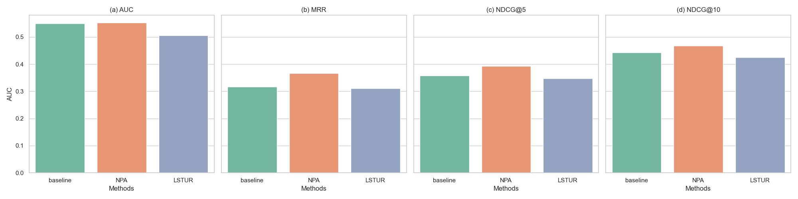
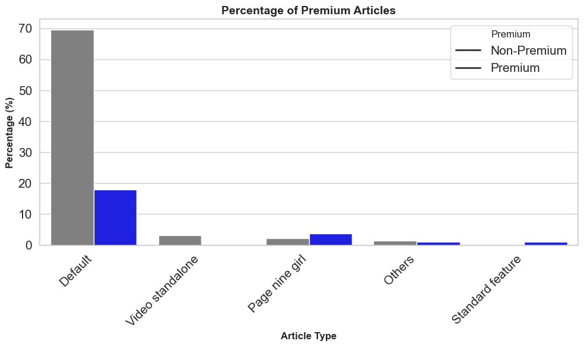
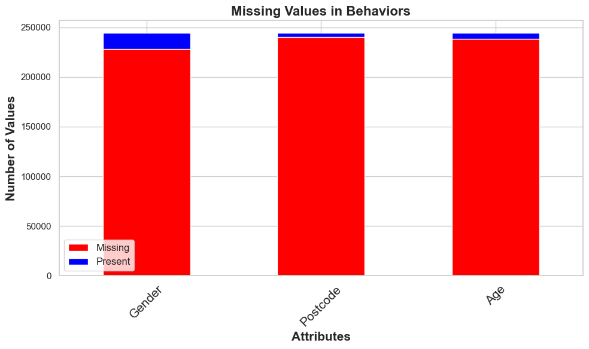
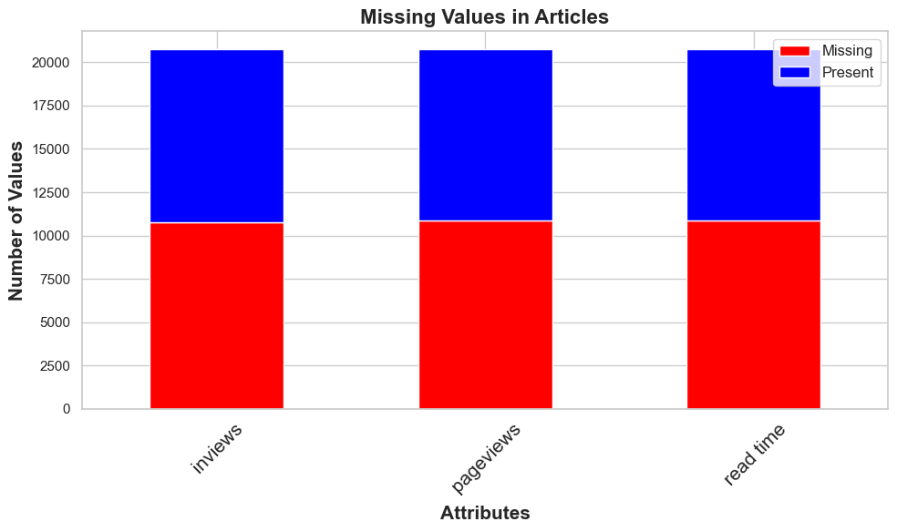
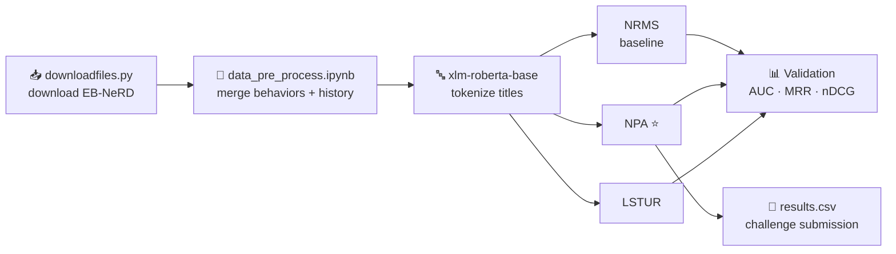
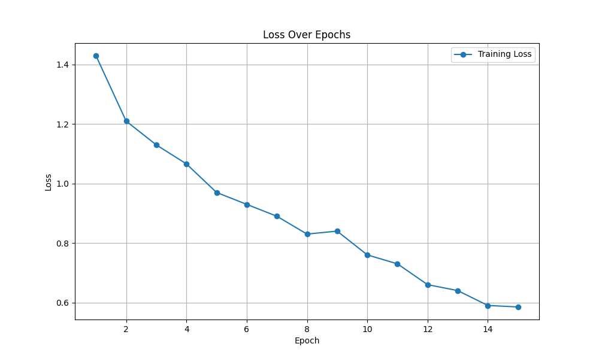
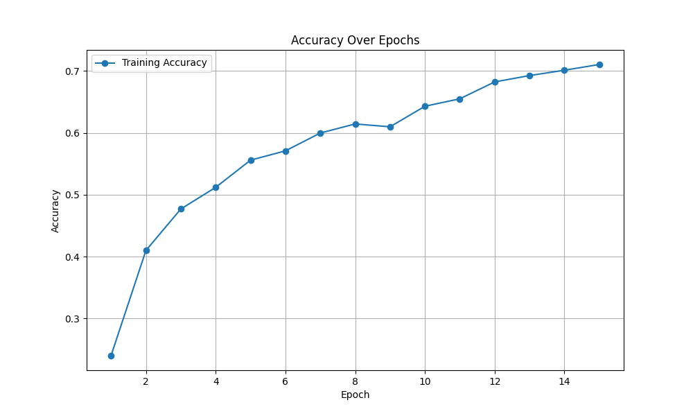

<div align="center">

# 📰 RecSys Challenge 2024: News Recommendation on EB-NeRD

### Team **WeKnowWhatYouWant** · Recommender Systems · TU Wien · Summer Semester 2024

[](https://www.recsyschallenge.com/2024/)
[](https://recsys.eb.dk/)
[](https://www.python.org/)
[](https://www.tensorflow.org/)
[](https://huggingface.co/xlm-roberta-base)
[](https://docs.conda.io/)

**🏆 Best model: NPA, which beat the NRMS baseline and LSTUR on MRR, nDCG@5 and nDCG@10**

[Overview](#-overview) •
[Data](#-data) •
[Models](#-models) •
[Approach](#%EF%B8%8F-approach) •
[Results](#-results) •
[Challenges](#%EF%B8%8F-challenges) •
[Setup](#-setup) •
[Team](#-team)

<br/>



</div>

---

## 🎯 Overview

Our entry to the **[ACM RecSys Challenge 2024](https://www.recsyschallenge.com/2024/)**. The task is to predict which news articles a user will click, using the **Ekstra Bladet News Recommendation Dataset (EB-NeRD)**.

We implemented and compared three neural news recommenders:

| Model | Role | Key idea |
|:--|:--|:--|
| **NRMS** | Baseline (given by the organizers) | Multi-head self-attention news & user encoders |
| **NPA** ⭐ | Assigned algorithm | Personalized attention at word and news level |
| **LSTUR** | Algorithm of our choice | Long-term (user ID embedding) + short-term (GRU) user representation |

Models are evaluated with **AUC**, **MRR**, **nDCG@5** and **nDCG@10**.

---

## 📚 Data

**EB-NeRD** contains user behavior logs from the Danish news site *Ekstra Bladet*, collected over **6 weeks (27 April – 8 June 2023)**. It comes in *demo*, *small* and *large* versions, each split into train and validation sets, plus a separate test set.

| File | Content |
|:--|:--|
| `behaviors.parquet` | Impression logs: in-view and clicked articles, read time, scroll %, device, subscription, demographics |
| `history.parquet` | Each user's click history with timestamps, read times and scroll % |
| `articles.parquet` | Title, subtitle, body (Danish), categories, premium flag, NER, topics, sentiment, engagement stats |
| Artifacts | Pre-computed article text embeddings and image embeddings |

### Exploratory analysis

<div align="center">

<br/><sub><i>Most "default" articles are regular, but premium articles dominate other types. Premium articles can't be recommended to non-premium users.</i></sub>
</div>

<br/>

<p align="center">
  
  &nbsp;
  
</p>
<p align="center"><sub><i>Left: over 90% of gender, postcode and age values are missing from the behaviors data, so those columns are unusable. Right: about half of the article engagement stats are missing.</i></sub></p>

---

## 🧠 Models

<table>
<tr>
<td width="50%" valign="top">

### NPA: Personalized Attention
*[Wu et al., KDD 2019](https://doi.org/10.1145/3292500.3330665)*

- Content-based: a **CNN** learns news representations from titles
- User representation learned from **clicked news**
- **Word-level** personalized attention finds the words that matter to each user
- **News-level** personalized attention finds the past clicks that matter

</td>
<td width="50%" valign="top">

### LSTUR: Long- & Short-term User Representations
*[An et al., ACL 2019](https://doi.org/10.18653/v1/P19-1033)*

- News encoder learns from titles
- **Long-term** preferences from user ID embeddings
- **Short-term** preferences from recently browsed news through a **GRU**
- Two ways to combine both representations

</td>
</tr>
</table>



---

## ⚙️ Approach

1. **Baseline.** Ran the NRMS baseline from the [`ebnerd-benchmark`](https://github.com/ebanalyse/ebnerd-benchmark) repository.
2. **Data.** Downloaded the data with `downloadfiles.py`. `data_pre_process.ipynb` then merges the behavior and history Parquet files and keeps only the needed columns (user, history article IDs, in-view articles, clicked articles, impression ID) to save memory.
3. **Text encoding.** Article titles are tokenized with the HuggingFace **`xlm-roberta-base`** model and tokenizer.
4. **Training.** NRMS, NPA and LSTUR were trained on the **EB-NeRD small** dataset and evaluated on its validation set.
5. **Optimization.** NPA did best in the first tests, so we focused on it. We tried hyperparameter tuning with **Keras Tuner**, but frequent crashes stopped it from finishing.
6. **Submission.** Predictions on a sample of the test set were written to a submission file in the format the RecSys Challenge requires.

---

## 📊 Results

**NPA** gave our best results. It slightly outperforms both the NRMS baseline and LSTUR, most clearly on **MRR, nDCG@5 and nDCG@10** (see the chart at the top). We think the personalized attention mechanism helps: different users can pay attention to different parts of the same article.

<p align="center">
  
  &nbsp;
  
</p>
<p align="center"><sub><i>NPA training loss and accuracy over epochs. We used early stopping once the model started to overfit.</i></sub></p>

<details>
<summary><b>⚖️ Advantages & disadvantages (click to expand)</b></summary>

<br/>

| | NPA | LSTUR |
|:--|:--|:--|
| ✅ | Personalized attention makes recommendations more relevant | Captures both long- and short-term preferences |
| ✅ | Works well on text-heavy data | Adapts quickly to changes in user behavior |
| ❌ | Complex to implement and tune | Complex; needs careful tuning |
| ❌ | Needs a lot of compute | Needs a lot of past and recent interaction data |
| ❌ | Cold-start problem | Cold-start problem |

</details>

---

## ⚠️ Challenges

| Problem | Impact |
|:--|:--|
| 🧠 **RAM** | The baseline dataloader used **over 120 GB of RAM**, far more than a 32 GB laptop has, so we switched to the *small* dataset |
| 🐢 **Inefficient benchmark code** | Training and prediction took hours even on the cluster. Rewriting it in PyTorch wasn't possible in the time we had |
| 🖥️ **Cluster resources** | Jobs stopped without errors. Preprocessing the full test set only worked on GPU servers |
| 📦 **Test set size** | Merging the test history and behaviors gives **~13.5M rows**. Full predictions took days and crashed, so we sampled **10K rows** |
| 🔁 **Reproducibility** | Weights trained locally didn't work on the cluster, possibly because of different CUDA drivers |
| 🎯 **Beyond-accuracy metrics** | Without predictions for the full test set we couldn't compute diversity, serendipity, novelty or coverage |

**Possible next steps:** predict the test set in chunks of about 500K rows, rewrite the dataloaders to be more efficient, train on the full dataset, and fill in missing features such as age.

---

## 🚀 Setup

The environment follows the conda setup from [`ebnerd-benchmark`](https://github.com/ebanalyse/ebnerd-benchmark).

```bash
git clone https://github.com/wojo501/recommender_systems.git
cd recommender_systems

# Creates the conda environment, installs dependencies,
# runs the chosen algorithms and produces results.csv
bash run.sh
```

To run the steps one at a time:

1. `python downloadfiles.py`: download and unzip EB-NeRD
2. `data_pre_process.ipynb`: merge and preprocess the data, and sample the test set
3. Run the NRMS / NPA / LSTUR notebooks to train, validate and predict

> 💡 Running the full *large* dataset needs much more than 32 GB of RAM. Start with *demo* or *small*.

---

## 👥 Team

<div align="center">

| Member | Contribution |
|:--|:--|
| **Stefan Hamm** | Initial setup & conda environment, data preprocessing, LSTUR, `run.sh`, final report |
| **Petar Soric** | NPA implementation, training & evaluation, final presentation |
| **Eva Pleše** | Dataset analysis & graphics, presentation slides, final report |
| [**Wojciech Michaluk**](https://github.com/wojo501) | Baseline, dataset analysis & graphics, final report |
| **Marko Gugleta** | NPA implementation, hyperparameter tuning, final presentation |

<sub>TU Wien · Recommender Systems · SS 2024</sub>

</div>

---

## 📚 References

1. [ebanalyse/ebnerd-benchmark](https://github.com/ebanalyse/ebnerd-benchmark): benchmark repository for EB-NeRD
2. [recommenders-team/recommenders](https://github.com/recommenders-team/recommenders): best practices for recommendation systems
3. [RecSys Challenge 2024](https://www.recsyschallenge.com/2024/)
4. An et al. *Neural News Recommendation with Long- and Short-term User Representations.* ACL 2019. [doi:10.18653/v1/P19-1033](https://doi.org/10.18653/v1/P19-1033)
5. Conneau et al. *Unsupervised Cross-lingual Representation Learning at Scale.* 2019. [arXiv:1911.02116](http://arxiv.org/abs/1911.02116)
6. Kolb, Nalis, Neidhardt. *Like a Skilled DJ: An Expert Study on News Recommendations Beyond Accuracy.* INRA @ RecSys 2023. [PDF](https://ceur-ws.org/Vol-3561/paper6.pdf)
7. Wu et al. *NPA: Neural News Recommendation with Personalized Attention.* KDD 2019. [doi:10.1145/3292500.3330665](https://doi.org/10.1145/3292500.3330665)
